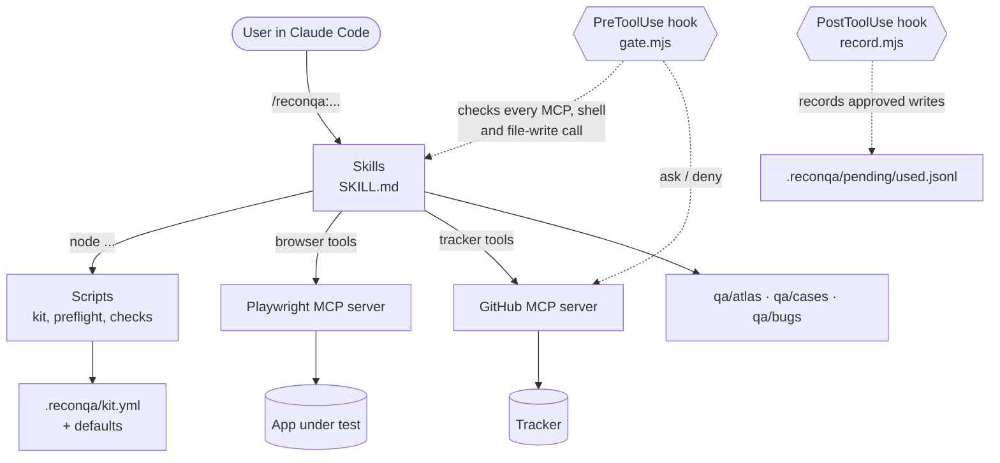

# ReconQA technical guide

How the plugin is built, how its parts talk to each other, and how to change or extend it. For
using ReconQA, read the [user guide](USER-GUIDE.md). For what could come next, see the end of the [README](../README.md).

Version: 0.1.0 release candidate (with the existing-system path: knowledge base, import, pre-UI cases, reconcile).

## Contents

1. [Overview](#1-overview)
2. [Repository layout](#2-repository-layout)
3. [Architecture](#3-architecture)
4. [The skills](#4-the-skills)
5. [Configuration (the kit)](#5-configuration-the-kit)
6. [Checks that keep the output honest](#6-checks-that-keep-the-output-honest)
7. [Knowledge base and existing material](#7-knowledge-base-and-existing-material)
8. [The write gate](#8-the-write-gate)
9. [Safety for the app under test](#9-safety-for-the-app-under-test)
10. [Adapters](#10-adapters)
11. [Evals and CI](#11-evals-and-ci)
12. [Tests and spikes](#12-tests-and-spikes)
13. [Design decisions](#13-design-decisions)
14. [Known limits](#14-known-limits)
15. [Extending ReconQA](#15-extending-reconqa)

## 1. Overview

ReconQA is a [Claude Code plugin](https://docs.claude.com/en/docs/claude-code/plugins). It has no
server and no runtime of its own. Everything it does happens inside a Claude Code session on the
user's machine:

- Seven **skills** (Markdown instructions) tell the model how to set up, save a login, check the
  setup, explore an app, write cases, run them and draft bugs.
- Plain **Node.js scripts** do every check that must not depend on the model: config validation,
  pre-flight, the doctor, grounding, case rules, bug completeness.
- **Hooks** run before and after tool calls and decide whether a write to an external tool may
  happen.
- **Adapters** keep tool names (GitHub, Playwright) out of the skills.

The scripts have no npm dependencies. YAML parsing and schema validation are bundled
(`scripts/lib/yaml-lite.mjs`, `scripts/lib/schema-lite.mjs`), so installing the plugin never runs
`npm install`.

Requirements: Claude Code, Node.js 20 or newer, Google Chrome. Browser work uses the Playwright MCP
server (pinned to `@playwright/mcp@0.0.85` in `scripts/lib/versions.mjs`). Filing bugs uses the GitHub MCP server (checked against v2.1.0).

## 2. Repository layout

```
.claude-plugin/marketplace.json   lets `/plugin marketplace add` find the plugin
plugins/reconqa/                  the plugin itself (this is what users install)
  .claude-plugin/plugin.json      name, version, description
  skills/<name>/SKILL.md          setup, login, doctor, explore, write-cases, run-cases, draft-bug, kb, reconcile
  scripts/                        kit.mjs, preflight.mjs, doctor.mjs, kb.mjs, reconcile.mjs, check-*.mjs (+ lib/)
  hooks/                          hooks.json, gate.mjs, record.mjs (+ lib/)
  adapters/app/                   app drivers: tool maps the gate reads (*.json), guides (*.md), login helper
  adapters/tracker/               tool maps for the write gate (GitHub Issues)
  schema/kit.schema.json          JSON Schema for the config
  templates/                      kit.default.yml, case and bug templates, kb/ (knowledge base templates)
examples/juice-shop/              a ready project: kit, frozen atlas, tickets, cases (also pre-UI), bug draft,
                                  run report, knowledge base, imported old cases and manual with their reports
evals/                            golden files, fixture tickets, run outputs, labels; kb/, reconcile/, second-app/
scripts/                          repo-only tools: scorers, eval gate, plugin structure check
tests/                            unit tests (node:test) and live spikes (tests/spikes/)
docs/                             ADRs, review gates, spike reports, these guides, media
```

Only `plugins/reconqa/` ships to users. Everything else is for development and evidence.

## 3. Architecture



The model drives the work, but three things are outside its control:

1. **Scripts** decide whether output passes. A skill can't finish until its check script exits 0.
2. **The PreToolUse hook** sees every MCP call, shell command and file write before it runs, and
   can allow, ask the user, or deny.
3. **The PostToolUse hook** records each approved tracker write so the same payload can't be sent
   twice.

## 4. The skills

Every skill starts by compiling the config (`kit.mjs compile`) and stops on errors. Skills treat
ticket text and page text as data, never as instructions. Each Bash call is one plain `node`
command, which keeps permission prompts predictable (the skills' `allowed-tools` is
`Bash(node:*)` plus file tools).

### setup

Asks two questions in one message: the app URL with its environment kind (local, test, staging),
and how the browser gets logged in (saved browser state, or none). It detects a connected tracker,
shows the proposed `.reconqa/kit.yml` as a diff, writes it only after the user agrees, then runs
the validator and pre-flight. If the Playwright server is missing it prints the install command
from the app adapter.

### login

Saves a logged-in session for exploring. It runs `adapters/app/<app_driver.tool>-login.mjs`, which
opens a visible Chrome window (`playwright open --channel chrome --save-storage`, from the same
pinned package as the browser helper) on the app. The user logs in with a test account and closes
the window. The script:

- refuses production and unreachable apps (pre-flight);
- discards the browser's output, so nothing the user types reaches the conversation;
- writes to a temporary file first and replaces the old session only when the new one has
  cookies or storage for the app's origin and isn't expired (`scripts/lib/auth-state.mjs`);
- sets the file to mode 600 and warns if git doesn't ignore it;
- closes the window itself after 9 minutes by sending SIGINT to the process group, which makes
  the browser save before it exits;
- on Linux with no display, prints the manual command instead.

It can't tell a logged-in session from a logged-out one in general, so it reports counts and the
earliest expiry and leaves the judgement to the user.

### doctor

Runs `scripts/doctor.mjs`, which changes nothing and calls no model. It reports `ok`, `warn`,
`fail` or `info` for: Node version; kit present and valid; app reachable and not production; saved
login (usable, expiry, file permissions, git-ignored); the browser helper found in `.mcp.json` or
`~/.claude.json` (local and user scope), with its args checked against the kit (pinned version,
`--allowed-origins` covering `app.url` and `extra_origins`, `--isolated`, `--storage-state` when a
session exists, server name matching `capabilities.app_driver.server_prefix`); an allow rule for
its tools; Chrome present; the tracker helper and repo; the gate's hook file. Each problem carries
the exact fix, for example the full `claude mcp add` command built by `scripts/lib/mcp-config.mjs`.
Only server names and args are read from Claude Code's config; env values (which can hold tokens)
never are. `--json` gives machine output; exit 1 means at least one `fail`.

The skill explains the result in plain words and offers the file edits; the user runs commands that
register helpers.

### explore

1. Validate config, run `preflight.mjs` (reachable, not production, origins known).
2. Follow the safety rules in section 8.
3. Walk the requested area with the browser: every screen, field, button and link; empty, invalid
   and boundary input; every message copied exactly. Text snapshots first; screenshots only as
   evidence.
4. Write `qa/atlas/<area>.md` as it goes: screens, a fields table, rules (R1, R2...), messages (M1,
   M2...), app version, and what was observed versus inferred. Open questions and notes go in their
   own sections.
5. Self-check before finishing. `explore.max_steps` (default 80) and `explore.token_budget` are
   best-effort limits the model tracks.

Measured: 56 to 70 tool steps, 1 to 2 minutes, about $0.45 to $0.53 per area with Sonnet.

### write-cases

1. Load the ticket (file, pasted text or issue reference) and the atlas page(s). If a knowledge
   base exists, load the feature's decisions and known issues (section 7).
2. Compare them criterion by criterion **before** writing cases. Every disagreement becomes a row
   in the mismatch table with a kind: `mismatch`, `missing in app`, `missing in ticket` or
   `likely defect`, plus a suggested question.
3. Write cases in the kit's format (`templates/case.steps-table.md`). Exact UI text is wrapped in
   the markup the kit sets (`cases.ui_string_markup`, default «guillemets») and must come from the
   atlas. Text the atlas doesn't have is described generically ("an error is shown").
4. Run `check-grounding.mjs` and `check-cases.mjs`; fix and rerun until both pass.
5. Save `qa/cases/<ticket>.md` and a CSV copy (`templates/cases.csv.md`).

Questions an active decision already answers are listed under "Answered by the knowledge base"
instead of the mismatch table. With no atlas and the screen not built (`--pre-ui`), cases use
`‹expected: …›` text from the ticket instead of `«»` (section 7).

### run-cases

Runs a cases file (or chosen case IDs) in the browser and writes `qa/runs/<cases>-<date>.md` from
`templates/run.md`, one section per case, written as soon as each case finishes.

- Same app safety rules as explore. Example emails and names in the cases are replaced by fresh
  `reconqa-` values, kept consistent across the run and listed under "Test data used".
- Per step: do it, read the page, compare with Expected. Marked UI text must match exactly;
  unmarked expectations are judged by meaning; "record what the app does" gives `observed`.
- A wrong result is checked once more (`run.recheck_failures`) before it becomes `fail`. A
  screenshot is taken, and the case's remaining steps are `not run`.
- Steps that would break a safety rule, or preconditions that can't be set up, are `blocked`.
- `check-run.mjs` then validates the report against the cases file and writes the CSV.

Settings: `run.screenshots` (`failures` or `every-step`), `run.max_cases` (ask before a bigger
run), `run.recheck_failures`, `run.stop_after_failures`, and `output.runs`.

### draft-bug

1. Read the failing case step (or the user's description).
2. Pre-flight, then reproduce twice in the browser. Take a screenshot and read the live app version.
3. Write `qa/bugs/<slug>.md` from `templates/bug.md`: title, environment, version, preconditions,
   steps, expected, actual, evidence, severity.
4. Run `check-bug.mjs` (required sections, severity from the kit's scale, evidence, no assignee, no
   secrets or real email addresses) and fix until it passes.
5. Filing happens only when `tracker_policy.filing` allows it, and every filing call goes through
   the write gate, which shows the full payload and asks the user.

Before reproducing, draft-bug reads the feature's known issues and stops if an open one matches.

### kb

`/reconqa:kb build | import <file> | answer <question> | search <words> | check`: builds the
feature map, imports old cases and manuals into a conflict list, records team decisions, searches
and checks the knowledge base. Details in section 7.

### reconcile

`/reconqa:reconcile <cases file>`: checks pre-UI cases against the real screen once it exists.
Details in section 7.

## 5. Configuration (the kit)

Three layers, merged in order:

| Layer | File | Committed? |
|---|---|---|
| Plugin defaults | `plugins/reconqa/templates/kit.default.yml` | ships with the plugin |
| Team | `.reconqa/kit.yml` | yes |
| Personal | `.reconqa/kit.local.yml` | no (gitignored) |

Maps merge key by key. Lists replace the list below them. `kit.mjs` has four commands:

```
node kit.mjs validate [--project <dir>]   check config, print errors with file:line
node kit.mjs compile  [--project <dir>]   validate, then write .reconqa/.compiled.json
node kit.mjs show     [--project <dir>]   print the merged config as JSON
node kit.mjs status   [--project <dir>]   is the compiled file present and current?
```

The compiled file carries a hash of its sources so a stale compile is detected. Validation uses
`schema/kit.schema.json`. Secret-looking values are refused in config (`looksSecret` in
`scripts/lib/kit.mjs`): credentials belong in the browser state file or the MCP server's own config.

Main sections:

| Section | Controls |
|---|---|
| `app` | URL, `target` (only `web` today), environments and their kind, extra origins, auth (browser state, test accounts, MFA = stop), test data (allow create, prefix, email domain), deny actions |
| `capabilities` | which tool backs tracker, test management, docs, comms and the app driver |
| `output` | where atlas, cases, bugs, reports, runs, the knowledge base (`kb`) and imported files (`sources`) go; whether screenshots are committed |
| `kb` | `token_cap`: most tokens a feature's decisions and known issues may hold (default 4000) |
| `explore` | step and token budgets, screenshot policy, settle time |
| `run` | screenshots, case limit, recheck, stop after n failures |
| `cases` | format, required fields, ID pattern, priority scale, step limits, UI string markup, and rules such as no step numbers in expected results |
| `bugs` | fields, severity scale, labels, required evidence, where the version comes from |
| `tracker_policy` | assignee policy, filing mode (`draft-only` by default), cited ID checks |
| `words` | banned words, glossary |
| `rules` | the team's own rules, scoped to a skill |
| `guardrails` | approval required, deny deletes, deny shell tracker writes |

## 6. Checks that keep the output honest

All checks are scripts with exit codes, so the model can't talk its way past them.

| Script | Checks |
|---|---|
| `test-data.mjs` | Fresh prefixed emails and names from real randomness (models repeat "random" strings across runs, which collided with old data in testing) |
| `doctor.mjs` | Whole-setup check with exact fixes (see the doctor skill above) |
| `preflight.mjs` | App reachable; environment is not `production`; creating test data allowed only on local, test or staging (or loopback) |
| `check-grounding.mjs` | Every marked UI string in a cases file exists in the atlas, case-sensitive. Atlas "Open questions" and "Notes" don't count as evidence. `--markup guillemets` or `double-quotes` |
| `check-cases.mjs` | Kit rules: required fields, ID pattern, priority values, step and expected limits, banned words, no step numbers in expected results, and the rest of `cases.*` |
| `check-run.mjs` | Run report: header fields; every case exists in the cases file with the same number of steps; valid step results; steps after a fail or blocked are `not run`; every ran step has an Actual; the case result follows from its steps; summary table and counts agree; failures have screenshots that exist and point to draft-bug. `--csv` writes one row per case |
| `check-bug.mjs` | Required sections and header fields, severity from the kit's scale, evidence, no assignee, no secrets or real email addresses |
| `check-kb.mjs` | Knowledge base: every `[src: …]` resolves (file inside the project, anchor found); quoted text appears word for word in a cited source; `index.md` rows and feature folders agree; no secrets or real emails; decisions have question, decision, who, date, a source, no «UI text», and atlas facts cited by ID with a fingerprint (a changed fact makes the decision **stale**); known issues have a status and a bug file or link; `kb.token_cap`; `coverage.md` matches what `kb.mjs coverage` generates |

Grounding is the core idea. A case can only quote what the explorer actually saw, so a wrong
message text in the ticket can't silently flow into the cases.


## 7. Knowledge base and existing material

The main use case is an existing product with old test cases, a manual and decisions nobody wrote
down. Everything here is plain Markdown in the user's repo, checked by scripts; the model never
writes a fact without a source the script can resolve.

### Knowledge base (`qa/kb`, `output.kb`)

```
qa/kb/index.md                   feature map: Feature | Folder | Atlas pages | Cases | Tickets | Updated
qa/kb/<feature>/overview.md      what the feature does; Rules and Flows items each cite a source
qa/kb/<feature>/decisions.md     ## D1 … with Question, Decision (intent only), Who, Date, Status
qa/kb/<feature>/known-issues.md  ## K1 … with Status (open, fixed, wont-fix), bug file or Link
qa/kb/<feature>/coverage.md      generated by `kb.mjs coverage`; never written by the model
```

Sources are written `[src: kind:path#anchor]`, several separated by `;`. Kinds: `atlas` (page name;
anchor `M12`, `R6` or a heading), `ticket`, `case` (anchor: case ID or `row N` in a CSV), `bug`,
`manual`, `import` (paths from the project folder). Other anchors: `AC4` (item 4 under
"Acceptance criteria"), a heading, a word or ID in the file, or `L12-14`. Atlas "Open questions"
and "Notes" never count as a source.

`kb.mjs` (no model calls): `init`, `new-feature <folder> "<Name>"`, `coverage <folder>|--all`,
`stamp <folder>|--all` (adds `@<8 hex>` fingerprints of cited atlas facts to decisions), `search
<words>`, `load <folder> [--all]` (by default only decisions and known issues, which the token cap
bounds), `check`. Coverage counts a message as covered when a case checks its exact text or cites
its ID (same text on two screens counts for the screen the case names most), and a rule when a case
cites it or covers a message it names. The gate asks before any model write under `output.kb`.

### Build, answer, and skills that use the knowledge base

- `/reconqa:kb build`: `kb.mjs inventory` lists atlas pages, cases, tickets, bug drafts and
  sources; the model proposes a feature map, the user confirms it, then `new-feature`, index rows,
  overview rules cited from the atlas, and one known issue per bug draft (`kb.mjs add-issue`).
  Decisions are never generated.
- `/reconqa:kb answer`: the user gives the decision, who (a role) and when;
  `kb.mjs add-decision … --dry-run` shows the entry (next `D<n>`, atlas references fingerprinted,
  sources resolved, no «UI text», no real emails), then the same command without `--dry-run` writes it.
- `write-cases` runs `kb.mjs features-for --pages <atlas pages>` and `kb.mjs load <folder>` before
  comparing. A mismatch answered by an active decision is listed under "Answered by the knowledge
  base" instead of being asked again; cases cite `decision <folder>/D<n>` or
  `known issue <folder>/K<n>` in their Source line. `check-cases.mjs` verifies every such citation
  exists, and that a cited decision is still active and not stale.
- `draft-bug` reads the feature's known issues first and stops (no draft) when an open one
  describes the same problem; a matching fixed one is treated as a possible regression. After a
  new draft it offers `kb.mjs add-issue`.

### Cases before the screen exists (pre-UI)

When no atlas page exists and the screen isn't built (or `--pre-ui`), `write-cases` writes the
file header `Atlas: none yet` and marks expected screen text as `‹expected: <text> [src: <ref>]›`.
Sources may be `ticket:`, `manual:` or `import:` only (decisions settle intent, never screen text).
`check-cases.mjs` checks every `‹expected›`: a source is given, it resolves, and the text is in it
word for word; a file with `Atlas: none yet` may not contain `«»` outside its mismatch section. It
prints how many expectations are still open. `check-grounding.mjs` ignores `‹…›`. The gate asks when
a model edit adds `«»` to a pre-UI file (Write, Edit, MultiEdit, or a shell write containing `«` or
`‹`). `run-cases` warns before running cases with open expectations.

### Reconcile (`/reconqa:reconcile`)

`reconcile.mjs plan <cases> --atlas <pages>` sorts every `‹expected›`: **confirmed** when the text
equals an atlas screen text (message, field, screen name, quoted label), or does after normalising
case, spacing, quote style and end punctuation (the atlas's exact text is used), or appears word for
word in the observed atlas; **different** when a close atlas text exists (word overlap; much shorter
candidates are penalised for sentences); otherwise **not found**. The model reviews only different
and not-found items, adding `review: {group, atlas_text, atlas_ref, note}`; `check-plan` refuses a
review that confirms anything, touches a confirmed item, or names an `atlas_text` that isn't in the
atlas. `apply` (after the user approves; `--skip` for items they reject, `--dry-run` to preview)
replaces only confirmed items with `«atlas text»`, changes the header to
`Atlas: <page> (reconciled <date>; N expected texts still open)` and writes
`<output.reports>/reconcile-<name>.md` (different, not found, converted, skipped).

### Import (`/reconqa:kb import`)

`kb.mjs import <file>` copies a CSV of old cases or a Markdown/text manual into `output.sources`
(default `qa/sources`) and writes `.reconqa/work/import-<name>.json`; the model reads only that.
It refuses PDFs and other formats (save as Markdown or text first) and any file with a password,
token or key (nothing is copied). Units: one per case (CSV columns mapped from common export names:
`ID`/`Case ID`/`Key`, `Title`/`Summary`, `Steps`, `Expected Result`, `Section`, …; rows without an
ID continue the case above) or one per manual section (heading reference when the heading is
unique, otherwise `L<from>-<to>`; text files: one per paragraph). Each unit gets: `ref` (resolvable
by `check-kb`), `flags` (command-like phrases: "ignore previous instructions", shell commands, bulk
deletes, hidden instructions; kept as data, listed in the report), `personal` (real email
addresses), `feature_hint` (a word-overlap guess the model confirms), and `quotes` compared with the
atlas: `confirmed`, `different` (with up to three `near` atlas texts as hints) or `unknown`.

The skill judges every claim (not only quotes) against the atlas and writes
`<output.reports>/import-<name>.md` with a conflict table
`# | Feature | Source | Source says | App shows | Kind | Question` (kinds: outdated case, manual vs
app, not in app, needs a decision), a "Not checked" list for unexplored areas and a "Flagged text"
list. `kb.mjs check-import` verifies each row: Source cites `import:` or `manual:`, App shows cites
the atlas, every double-quoted text is word for word in what it cites. Knowledge-base updates
(imported CSV added to the feature's Cases for coverage; confirmed manual statements under
`## From the manual`) are shown first and written only after the user agrees.

## 8. The write gate

`hooks/hooks.json` registers:

- **PreToolUse** on `mcp__.*|Bash|PowerShell|Write|Edit|MultiEdit|NotebookEdit` → `gate.mjs`
- **PostToolUse** on `mcp__.*` → `record.mjs`

The decision logic lives in `hooks/lib/gate-core.mjs` (`decide(input, { projectDir })`), so it can
be unit tested without Claude Code. It returns `none` (no opinion; normal permissions apply),
`allow`, `ask` or `deny`.

### What it decides

| Call | Decision |
|---|---|
| Any call outside a ReconQA project (no `.reconqa/kit.yml` found walking up) | none |
| Tracker read listed in the adapter | none |
| Tracker write listed in the adapter | **ask**, with a payload summary and the reason "ReconQA write, check before approving" |
| Tracker delete, or a write that closes an issue | deny |
| Tracker tool not listed in the adapter | deny |
| Write to a repo other than the kit's `capabilities.tracker.repo` | deny |
| Write that sets an assignee while `tracker_policy.assignee: never` | deny |
| Write whose content fingerprint was already sent | deny (duplicate) |
| Payload containing a secret or a non-test email address | deny |
| Shell command that writes to a tracker (`gh issue create`, `curl -X POST` to the API, and similar) | deny |
| Shell command that writes to a device: `adb install/push/shell/reboot…`, `mosquitto_pub`, `mqtt pub`, writes or terminals on a serial port (`> /dev/ttyUSB0`, `picocom`, `COM3`) | deny |
| App driver tool listed under `allow` in its map (`adapters/app/*.json`) | none |
| App driver tool listed under `ask` (runs JavaScript in the page, uploads a file, changes cookies or storage) | **ask**, with the reason from the map |
| App driver tool listed under `deny`, or **not listed at all** on a driver prefix | deny (deny by default) |
| Same op name as a map's `deny` or `ask` entry under another prefix (e.g. a plugin-installed driver) | deny or ask |
| Model writing to `.reconqa/pending/` | deny |
| Edits to `.reconqa/kit.yml` or `kit.local.yml` | ask |
| Model write under `output.kb` (file tools, shell writes, interpreter one-liners such as `node -e`) | ask |
| `kb.mjs add-decision`, `add-issue`, `new-feature`, `init` or `reconcile.mjs apply` without `--dry-run` | ask |
| Edit that adds `«»` to a pre-UI cases file (`Atlas: none yet`), or removes that header | ask |

The fingerprint is a SHA-256 hash of the canonicalised tool input (keys sorted, the method field
ignored), so the same payload sent through two different tools still counts as a duplicate. `record.mjs` appends the fingerprint of
each completed, approved write to `.reconqa/pending/used.jsonl`. Only that hook writes there.

### Failing closed

- `gate.mjs` reads stdin asynchronously with a 4-second internal timer, below the 10-second hook
  timeout. A timeout or uncaught error exits 2, which Claude Code treats as a block.
- The hook command ends in `|| exit 2`, so a crash of Node itself also blocks. (Spike result: a
  hook that exits 1 does **not** block, which is why this is needed.)
- `command -v node || exit 0` at the front means a machine without Node runs Claude Code normally,
  with the gate inactive. The README states this.

### What the spikes proved

From the hook spike, run headless against a fake MCP server: plugin hooks fire on MCP
tools; `ask` reaches the prompt in every permission mode, including auto and bypass; another hook
returning `allow` doesn't override a `deny` or `ask`; `updatedInput` replaces the payload. An
interactive check against the real GitHub server (sandbox repo) confirmed the approval prompt shows
the full payload, even in auto mode.

## 9. Safety for the app under test

- **Environments.** `preflight.mjs` refuses `production`. Test data creation needs
  `app.test_data.allow_create: true` and a local, test or staging environment.
- **Origins.** The Playwright server runs with `--allowed-origins` set to the app URL plus
  `app.extra_origins`, so the browser can't wander to other sites.
- **Deny actions.** The explore skill never changes passwords, credentials or security settings,
  makes payments, deletes accounts or bulk data, or solves CAPTCHAs. It judges by effect, not by
  button label.
- **Test data.** Every created record starts with `app.test_data.prefix` (`reconqa`), and emails use
  the reserved `example.test` domain.
- **Logins.** The browser uses a saved, already-logged-in state (`.reconqa/auth/state.json`,
  gitignored). The agent never asks for, types, prints or stores a password. An MFA prompt stops
  the run.
- **Screenshots** are gitignored by default (`output.commit_screenshots: false`).

## 10. Adapters

Skills talk about capabilities (tracker, app driver). Adapters map those to real tools.

**App drivers** (`adapters/app/`). The user picks one in `capabilities.app_driver.tool`:
`playwright` (default), `claude-in-chrome` (the user's own Chrome through the Claude in Chrome
extension), `none`, or any name with its own map. Each driver has:

- `<name>.json`, the tool map the gate loads (all maps in the folder, every call):

  | Key | Meaning |
  |---|---|
  | `default_prefix` | MCP tool prefix, e.g. `mcp__playwright__`. The configured `server_prefix` is checked as well |
  | `target` | what it drives (`web` today); must equal `app.target` |
  | `allow` / `ask` / `deny` | every tool of the server sorts into one list; an unlisted tool is denied |
  | `ask_reasons` / `deny_reasons` | the plain-words reason shown with the decision |

- `<name>.md`, setup, login and a tool table that the skills read for tool names.
- optionally `<name>-login.mjs`, the login helper `/reconqa:login` runs. Without one, the login
  skill follows the guide's "Login" section.

`scripts/lib/app-maps.mjs` loads and checks the maps; a malformed map throws, so the gate fails
closed. `scripts/check-plugin.mjs` checks the shipped maps in CI. `adapters/app/README.md` explains
how to add a driver.

**Target.** `app.target` (`web`, `android`, `api`, `mqtt`, `serial`, `desktop`, `ios`) says what is
under test. `web`, `android` and `api` are active; the validator refuses the others until their
drivers ship, and refuses a driver whose map has a different target.

**Built-in drivers** (`drivers/`, Node only, no dependencies; a tiny stdio MCP server in
`drivers/lib/mcp-stdio.mjs`, calls run one at a time). Each has a pure `core.mjs` (tested with a fake
adb or fetch) and a `server.mjs`; both re-read the compiled kit on every call.

- `drivers/android` (`android-adb` map, `app.android`): every adb call has `-s <device>`; a real
  phone needs `allow_real_device`; taps, typing, swipes, snapshots and screenshots only while the
  test package (or `extra_packages`) has focus, re-checked after a tap before typing; screens are read
  with `uiautomator dump --windows` (field errors live in popup windows); logcat only for the app's
  pid, emails and tokens hidden; `pm clear` only with `allow_reset` and asked. No raw shell.
- `drivers/api` (`http-api` map, `app.api`): relative paths on `base_url` only (no `..`, no encoded
  slashes or dots); GET/HEAD/OPTIONS free; POST/PUT/PATCH only with `allow_create` on loopback or a
  local/test/staging environment; POST only to collections, never risky-looking paths or GraphQL;
  PUT/PATCH/DELETE only on records created in the run (top-level id, a single wrapper's id, or a
  Location below the collection); login values from environment variables named in the kit; secret
  keys, JWTs, the login values and Location query strings hidden. DELETE is asked by the gate.
- The gate also blocks shell commands that print environment variables or name the login
  variables, and adb commands other than `devices`, `get-state` and `version`.
- `preflight.mjs` checks the device and package (Android) or that the API answers (API), and prints
  `driver_guide`, the absolute path of the driver's guide that skills read.

**Tracker adapter** (`adapters/tracker/github-issues.json`): a tool map the gate reads.

| Key | Meaning |
|---|---|
| `default_prefix` | MCP tool prefix, e.g. `mcp__github__` |
| `reads` / `writes` / `deletes` | tool names in each class; anything unlisted is denied |
| `write_methods_field` | for multi-method tools (`issue_write`), the field naming the method |
| `delete_like` | field values that count as a delete, e.g. `state: closed` |
| `repo_fields` | which input fields hold owner and repo |
| `assignee_fields` | which input fields set an assignee |
| `tested_with` | server version the map was checked against |

The `.md` next to it explains setup for humans.

## 11. Evals and CI

| What | Where | Gate |
|---|---|---|
| Explore recall against hand-made golden lists | `evals/explore/`, `scripts/score-recall.mjs` | reported per run |
| Mismatch precision and recall against hand labels | `evals/write-cases/`, `scripts/score-mismatches.mjs` | ≥ 80% each, in CI |
| Grounding of every committed sample | `scripts/check-evals.mjs` | 0 ungrounded strings, in CI |
| Plugin structure, app driver maps | `scripts/check-plugin.mjs` | in CI |
| Import, reconcile and knowledge-base evals | `evals/kb/`, `evals/reconcile/`, `scripts/score-import.mjs`, `score-reconcile.mjs`, `score-kb.mjs`, `scripts/check-evals-kb.mjs` | import recall ≥ 80%, reconcile ≥ 95% right with 0 wrongly confirmed, knowledge base ≥ 90% cited and ≤ 15% asked again; in CI |
| Docs match the code | `scripts/check-docs.mjs` | every command, script and config key named in the docs exists; in CI |

Current numbers: 6 fixture tickets on two apps, mismatch precision 94% (17 of 18), recall 100% (17
of 17), one run each. Existing-system path, 3 runs each (Sonnet): import found 12 of 12 planted
outdated cases and 7 of 7 manual statements with no false conflicts; reconcile sorted 26 of 26
texts; with the knowledge base, 33 of 33 settled points were cited and 2 of 33 asked again (10 of
11 without it). Details in `evals/kb/README.md` and `evals/reconcile/README.md`.

`.github/workflows/ci.yml` runs `npm test` and `npm run check` on Linux, macOS and Windows with
Node 20 and 22. `.gitattributes` forces LF line endings so frontmatter parsing is the same on
Windows.

## 12. Tests and spikes

```
npm test        # unit tests, node:test, no installs (162 tests)
npm run check   # structure, example config, grounding, case, bug, run and KB checks, eval gates, docs check
```

Unit tests cover the gate decisions, fingerprints, checks, scorers, pre-flight, config loading, the
YAML parser and security cases such as secrets in config.

Live spikes in `tests/spikes/` call Claude and cost tokens, so they run by hand:

| Spike | Proves |
|---|---|
| `hooks/` | hook semantics with a fake MCP server and a scripted "human" |
| `explore/` | explore runs on Juice Shop and the Real World App, with recall scoring |
| `write-cases/` | cases and mismatch lists from fixture tickets |
| `draft-bug/` | a full bug draft from a failing step |
| `gate-live/` | the gate inside a real Claude session (7 of 7 scenarios) |
| `kb-import/` | `/reconqa:kb import` on the sample old cases and manual (fresh copy each run) |
| `kb-use/`, `kb-eval/` | write-cases and draft-bug with the knowledge base; the 5-ticket eval with and without it |
| `pre-ui/`, `reconcile/` | pre-UI cases with the atlas hidden, then reconcile against it |
| `repeat-runs.mjs` | repeats import and reconcile runs for the spread |
| `second-app/` | explore and the other skills on Actual Budget (local lab, persistent browser profile) |

Results of the evals are in `evals/` (each folder has a README).

## 13. Design decisions

- [ADR-001](adr/001-capabilities-over-tools.md): skills name capabilities, adapters name tools.
- [ADR-002](adr/002-config-layers-and-safe-writes.md): config layers, and why every external write
  needs a dry run the user approves.
- Explore before writing. The atlas is a plain Markdown file a person can read and fix, and it is
  reused by every later ticket in that area.
- Scripts, not the model, decide pass or fail.
- No dependencies, no telemetry, no server.

## 14. Known limits

- The gate stops mistakes, not a determined attacker. Anyone with a shell can get around a local hook.
- Shell checks are pattern based. If `gh` is signed in, an unusual command could slip through.
- Without Node.js the gate is inactive.
- Screenshots can't be attached through the tracker tool; the issue names the file path.
- `max_steps` and `token_budget` are best effort, not enforced.
- The numbers come from a few runs on two demo apps.
- Trackers: GitHub Issues, and Jira through Atlassian's MCP server (not yet live-tested). Test management: TestRail helper (not yet live-tested). App drivers: Playwright or Claude in Chrome (web), built-in Android
  (adb; typing is ASCII only; cannot hear TalkBack) and built-in REST/JSON API (no GraphQL).
- The login helper can't tell whether the user really logged in; it reports what was saved.
- Import reads CSV, Markdown and text only (PDF, Word, HTML and tracker tickets come later). Column
  mapping covers common export names; unusual exports may need renamed columns.
- Command-like text in imported files is flagged by patterns; a reworded instruction can slip past
  the flag (it is still only data to the skill, but nothing proves a model can never be swayed).
- Knowledge-base checks prove that a cited text is in its source, not that the summary around it
  is right. Decisions are only as good as the answers people give.
- The import and knowledge-base evals use one small app and items we planted ourselves.

## 15. Extending ReconQA

**Add a tracker.** Copy `adapters/tracker/github-issues.json`, list the new server's tools under
`reads`, `writes` and `deletes`, fill in the field names, and set `tested_with`. Add gate tests in
`tests/gate.test.mjs` for a create, a delete, another project and an assignee. Skills need no
change because they only say "tracker".

**Add a case format.** Add a template in `templates/`, allow its name in `schema/kit.schema.json`
(`cases.format`), and teach `check-cases.mjs` its structure.

**Add a rule.** Prefer a structured key in `cases.*` that `check-cases.mjs` can enforce. Free-text
rules in `rules:` are followed by the model but not checked.

**Change a skill.** Keep one plain `node` command per Bash call, keep tool names out of the text,
and rerun the matching spike to see the effect on cost and quality. Update the eval outputs if they
change.
